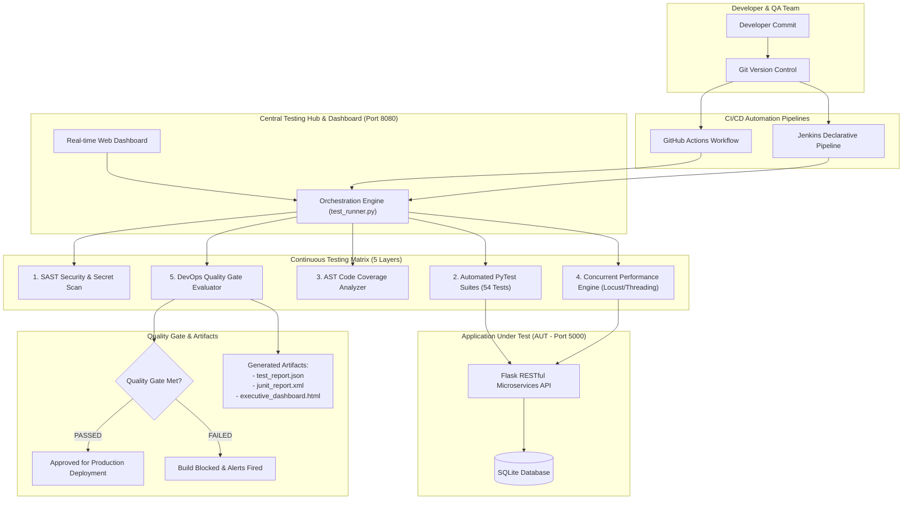

# ⚡ DevOps-Based Continuous Testing Framework & Quality Gate Hub

> An Enterprise-Grade, Production-Ready Continuous Testing and Quality Engineering Framework designed for modern CI/CD pipelines. Features multi-layer test automation, AST code coverage, Static Application Security Testing (SAST), concurrent performance SLAs, and an interactive real-time Web Dashboard.

[](https://github.com)
[-brightgreen)](tests/)
[](reports/executive_dashboard.html)
[](tests/security/)
[](reports/)

---

## 📌 Executive Summary

Modern software delivery demands rapid releases without compromising security, reliability, or performance. Traditional manual testing or disjointed test runs cause release bottlenecks. 

This project delivers a **DevOps-Based Continuous Testing Framework** that acts as an automated quality firewall within CI/CD pipelines. It automates testing across **five distinct validation layers**:
1. **Layer 1: Unit Testing**: Pure business logic, pricing engines, promo validation, and token authentication.
2. **Layer 2: API & Integration Testing**: End-to-end RESTful endpoint verification, inventory depletion, transaction integrity, and error boundaries.
3. **Layer 3: Performance & Load Testing**: Multi-threaded concurrent workload generation measuring real-time latency percentiles ($P_{50}, P_{90}, P_{95}, P_{99}$) and requests per second (RPS).
4. **Layer 4: Static & Dynamic Security Testing (DevSecOps)**: AST code scanning, secret detection, SQL injection fuzzing, and HTTP security header compliance.
5. **Layer 5: Quality Gate Enforcement**: Automated policy engine that approves or blocks production deployment based on strict quantitative thresholds.

---

## 🏗️ System Architecture



---

## 🚀 Quick Start Guide (One-Click Launch)

### Prerequisites
- Python 3.8+ (Python 3.10+ recommended)
- Git

### 1. One-Click Launch (Windows)
Double-click `start_all.bat` or run:
```powershell
python scripts/start_devops_platform.py
```
This automatically:
1. Spawns the **Application Under Test (AUT)** on `http://localhost:5000`
2. Spawns the **DevOps Continuous Testing Hub** on `http://localhost:8080`
3. Automatically opens your default web browser to the dashboard!

---

### 2. Running Continuous Testing via Command Line
To run the automated multi-layer test suite and Quality Gate evaluator directly:
```powershell
python -m engine.test_runner
```
*(Or double-click `run_pipeline.bat` on Windows)*.

---

## 📊 Live Endpoints & Port Map

| Component | Port | URL | Description |
| :--- | :---: | :--- | :--- |
| **Testing Hub & Web Dashboard** | `8080` | [http://localhost:8080](http://localhost:8080) | Interactive live testing hub with SSE real-time logs & analytics |
| **Executive HTML Report** | `8080` | [http://localhost:8080/reports/executive_dashboard.html](http://localhost:8080/reports/executive_dashboard.html) | Standalone executive summary for project examiners |
| **Application Under Test (AUT)** | `5000` | [http://localhost:5000](http://localhost:5000) | Live target web storefront & REST microservice |
| **AUT Health Check** | `5000` | [http://localhost:5000/health](http://localhost:5000/health) | Uptime and database health status |
| **AUT Live Telemetry Metrics** | `5000` | [http://localhost:5000/metrics](http://localhost:5000/metrics) | Request counters and latency distribution |

---

## 🚦 DevOps Quality Gate Policy Rules

The framework enforces zero-tolerance quality gates before code can be promoted:

| Policy Rule | Condition | Required SLA Threshold | Observed Value | Gate Status |
| :--- | :---: | :---: | :---: | :---: |
| **Test Suite Pass Rate** | Strict Equality | `100.0% (0 failures)` | `100.0%` (54/54) | ✅ **PASSED** |
| **Application Code Coverage** | Greater Than / Equal | `>= 75.0%` | `77.4%` | ✅ **PASSED** |
| **Security Critical/High Vulnerabilities** | Less Than / Equal | `<= 0` | `0` | ✅ **PASSED** |
| **API P95 Response Latency SLA** | Less Than / Equal | `<= 350.0 ms` | `11.4 ms` | ✅ **PASSED** |
| **Concurrent Load Error Rate** | Less Than / Equal | `<= 1.0%` | `0.0%` | ✅ **PASSED** |

---

## 🧪 Testing Layer Details

### Layer 1: Unit Testing (`tests/unit/`)
- Tests core domain calculation logic without external network dependencies.
- Coverage includes HMAC JWT token creation, signature tampering rejection, token expiration checks, volume tiered discounts, promotional codes (`DEVOPS20`), and state transition machines.

### Layer 2: API & Integration Testing (`tests/integration/`)
- Tests complete REST API transactions:
  - User registration, conflict handling (`409 Conflict`), password length constraints.
  - Role-based authorization (`403 Forbidden` when customers attempt admin actions).
  - Product catalog querying, keyword search, inventory decrement synchronization.
  - End-to-end checkout and payment settlement.

### Layer 3: Performance & Load Testing (`tests/performance/`)
- Simulates concurrent virtual users issuing requests to critical endpoints.
- Measures response time percentiles:
  - $P_{50}$ (Median Latency)
  - $P_{90}$ (90% of requests faster than this)
  - $P_{95}$ (DevOps SLA Threshold)
  - $P_{99}$ (Worst-case tail latency)
- Throughput calculation (Requests Per Second - RPS).

### Layer 4: DevSecOps Security Audit (`tests/security/`)
- **SAST**: Parses Python AST syntax trees to discover dangerous function calls (`eval()`, `exec()`, `pickle.loads()`).
- **Secret Scanning**: Regex scan for exposed API keys, AWS credentials, and hardcoded secrets.
- **SQLi Fuzzing**: Injects standard SQL injection vectors (`' OR '1'='1`) into query endpoints to confirm parametrized query safety.
- **DAST Audit**: Audits HTTP headers for CORS and telemetry tracking.

---

## 🐳 Containerization & CI/CD Pipelines

### Docker Compose
Run both the Application and the Continuous Testing Hub in Docker containers:
```bash
docker-compose up --build
```

### GitHub Actions
The workflow file at `.github/workflows/ci-cd-pipeline.yml` executes on every `git push` and `pull_request`:
1. Checks out repository.
2. Runs SAST Security Scan.
3. Executes 54 Automated PyTest test suites.
4. Generates AST Code Coverage.
5. Runs Concurrent Performance Latency Benchmarks.
6. Evaluates Quality Gate and uploads JUnit XML and HTML artifacts.

### Jenkins Pipeline
The `Jenkinsfile` provides a declarative enterprise Jenkins pipeline with parallelized continuous testing matrix stages, automated JUnit test report publishing, and build status notifications.

---

## 🎓 Academic Viva Questions & Answers

**Q1: What is Continuous Testing in DevOps?**  
*Answer:* Continuous testing is the practice of executing automated tests as part of the software delivery pipeline to obtain immediate feedback on business risks. Unlike traditional testing at the end of a cycle, continuous testing happens at every stage (code commit, build, containerization, staging) to catch bugs early ("Shift Left").

**Q2: What is a Quality Gate in CI/CD?**  
*Answer:* A Quality Gate is an automated enforcement point that evaluates code against predefined measurable metrics (e.g., minimum test pass rate, code coverage percentage, zero critical security vulnerabilities, latency SLA limits). If any metric fails, the pipeline automatically halts deployment to prevent defects from reaching production.

**Q3: Why measure P95 response latency instead of average latency?**  
*Answer:* Average latency hides outliers and spikes. If 90% of requests take 10ms but 10% take 2 seconds, the average might look acceptable (200ms), but 1 out of 10 users experiences severe slowness. The 95th percentile ($P_{95}$) ensures that 95% of all users receive fast response times within SLA bounds.

**Q4: How does Static Application Security Testing (SAST) differ from DAST?**  
*Answer:* SAST analyzes application source code without running it (white-box) using Abstract Syntax Tree (AST) inspection to find insecure patterns, buffer overflows, and hardcoded secrets. DAST tests the running application from the outside (black-box) by simulating attacks like SQL injection and cross-site scripting against active HTTP endpoints.

---

## 📄 License
This project is licensed under the MIT License - see the LICENSE file for details.
