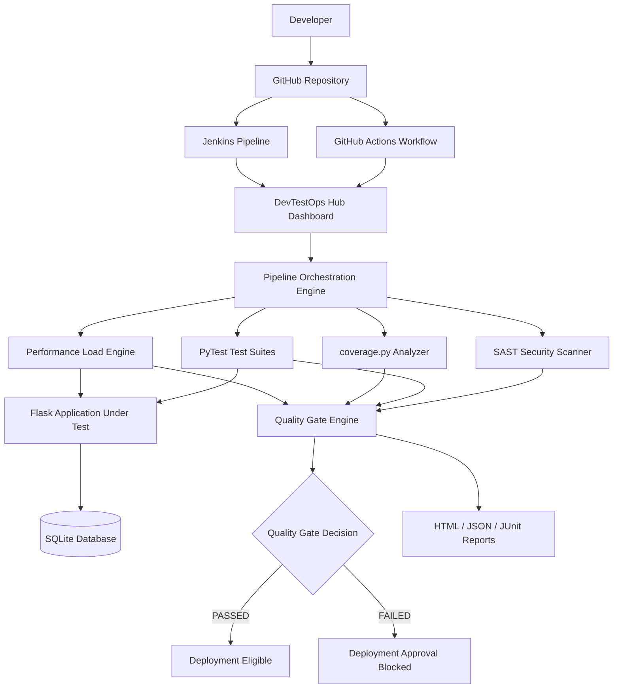

# ⚡ DevOps-Based Continuous Testing Framework & Quality Gate Hub

An automated DevOps Continuous Testing and Quality Engineering Framework designed to integrate functional testing, code coverage, security scanning, performance testing, and quality gate enforcement into a unified CI/CD-oriented platform.


---

## 📌 Executive Summary

Modern software delivery requires frequent releases without compromising software quality, security, reliability, or performance.

This project implements a **DevOps-Based Continuous Testing Framework** that acts as an automated quality control layer within a CI/CD-oriented software delivery process.

The framework integrates five major validation stages:

1. **SAST Security:** Source-code scanning and security vulnerability detection.
2. **Automated Functional Testing:** Unit, integration, and end-to-end workflow tests using PyTest.
3. **Code Coverage:** Actual executed source-statement coverage measurement using `coverage.py`.
4. **Performance Testing:** Concurrent request execution with latency and throughput measurements.
5. **Quality Gate Enforcement:** Automated evaluation of test results, coverage, security, and performance against predefined thresholds.

The platform also provides a web dashboard, live pipeline execution logs, persistent test execution records, and downloadable reports.

## 🏗️ System Architecture



## 🛠️ Technology Stack

| Component | Technology |
|---|---|
| Backend / AUT | Python, Flask |
| Frontend | HTML, CSS, JavaScript |
| Dashboard | Flask-based web dashboard |
| Automated Testing | PyTest |
| Code Coverage | coverage.py |
| Security Testing | Custom SAST scanner, AST analysis |
| Performance Testing | Python concurrent load engine |
| Database | SQLite |
| Containerization | Docker, Docker Compose |
| CI/CD | GitHub Actions, Jenkins |
| Version Control | Git, GitHub |
| Reporting | HTML, JSON, JUnit XML |
| Live Dashboard Updates | Server-Sent Events (SSE) |

## 🚀 Quick Start Guide

### Prerequisites

- Python 3.10 or later
- Git
- Docker Desktop
- Windows PowerShell or a compatible terminal

### 1. Clone the Repository

```powershell
git clone https://github.com/klu2300031196/Final_Project.git
cd Final_Project
```

### 2. Start Using Docker Compose

Build and start both application services:

```powershell
docker compose up -d --build
```

The platform starts two services:

- Application Under Test (AUT)
- Continuous Testing Dashboard

### 3. Access the Application

| Component | URL |
|---|---|
| Testing Dashboard | http://localhost:8080 |
| Target AUT Web Store | http://localhost:5000 |
| AUT Health Check | http://localhost:5000/health |
| AUT Metrics | http://localhost:5000/metrics |
| Executive HTML Report | http://localhost:8080/reports/executive_dashboard.html |
| JUnit XML Report | http://localhost:8080/reports/junit_report.xml |
| JSON Report | http://localhost:8080/reports/test_report.json |

### 4. Run the Pipeline

Open the dashboard:

http://localhost:8080

Click **Run Full Testing Pipeline**.

The dashboard displays the execution stages and live logs, followed by the quality gate verdict.

### 5. Run from Command Line

Alternatively, with the required Python dependencies installed:

```powershell
python -m engine.test_runner
```

The Windows launcher scripts are also available:

- `start_all.bat`
- `run_pipeline.bat`

### 6. Stop Docker Services

```powershell
docker compose down
```

This stops the containers without deleting the persistent database volume.

---

## 🚦 Latest Successful Pipeline Execution

**Execution ID:** `CT-RUN-1793888630`

**Execution date:** November 5, 2026

**Execution duration:** 2.68 seconds

<badge color="success">GATE: PASSED</badge>

| Metric | Actual Result |
|---|---:|
| Total executed test cases | 70 |
| Passed | 70 |
| Failed | 0 |
| Skipped | 0 |
| Additional deselected tests | 1 |
| Test pass rate | 100% |
| Overall code coverage | 92.9% |
| Statements analyzed | 506 |
| Covered statements | 470 |
| Missed statements | 36 |
| High/Critical security findings | 0 |
| Performance requests | 80 |
| Concurrent workers | 6 |
| Mean latency | 4.94 ms |
| P95 latency | 9.7 ms |
| Throughput | 1008.09 RPS |
| Performance error rate | 0% |
| Pipeline duration | 2.68 seconds |

### Quality Gate Policy Evaluation

The framework evaluates five predefined quality policies.

| Policy | Required Threshold | Actual | Status |
|---|---:|---:|---|
| Test pass rate | >= 100% | 100% | PASSED |
| Code coverage | >= 75% | 92.9% | PASSED |
| High/Critical vulnerabilities | <= 0 | 0 | PASSED |
| P95 latency | <= 350 ms | 9.7 ms | PASSED |
| Load error rate | <= 1% | 0% | PASSED |

**Final Verdict: 5/5 policies passed.**

The quality gate marked the build as eligible for deployment. This is a deployment eligibility decision; it does not mean that an actual production deployment occurred.

## 📊 Application Code Coverage

Coverage is measured using `coverage.py` based on executed Python source statements.

| Application Module | Total Statements | Covered | Missed | Coverage |
|---|---:|---:|---:|---:|
| `app/__init__.py` | 1 | 1 | 0 | 100% |
| `app/app.py` | 324 | 290 | 34 | 89.5% |
| `app/auth.py` | 63 | 61 | 2 | 96.8% |
| `app/models.py` | 54 | 54 | 0 | 100% |
| `app/services.py` | 64 | 64 | 0 | 100% |
| **Overall** | **506** | **470** | **36** | **92.9%** |

The overall measured coverage exceeds the configured 75% quality gate threshold.

## 🧪 Testing Layer Details

### Layer 1: SAST Security Scanning

The security scanner analyzes application source files to identify potentially unsafe coding patterns.

Security testing includes:

- Python AST-based source-code analysis.
- Detection of potentially dangerous function calls.
- Secret-pattern scanning.
- SQL injection resilience testing.
- Security header checks.

Latest execution: 5 files scanned and 0 high/critical findings.

### Layer 2: Automated Functional Testing

PyTest is used to execute automated unit, integration, and end-to-end workflow tests.

**Unit testing (`tests/unit/`)**

- Authentication and token validation.
- Password hashing.
- Pricing and discount calculations.
- Payment simulation.
- Order state transitions.

**Integration testing (`tests/integration/`)**

- User registration and login.
- Authentication and authorization.
- Product catalog and search.
- Order creation and payment lifecycle.
- API validation and error scenarios.
- Customer payment authorization checks.

**End-to-end testing (`tests/e2e/`)**

- Complete checkout workflow.

Latest full pipeline execution: 70 passed, 0 failed, 0 skipped, with 1 additional test deselected.

### Layer 3: Code Coverage Analysis

The framework uses `coverage.py` to measure executed source statements.

Coverage information is collected for application modules and included in the pipeline report.

Latest measured coverage: **92.9% (470 of 506 statements).**

### Layer 4: Performance and Load Testing

The performance engine generates concurrent requests against the Application Under Test.

It measures:

- P50 response latency.
- P90 response latency.
- P95 response latency.
- P99 response latency.
- Minimum and maximum latency.
- Requests per second.
- Request failure rate.

Latest execution used 6 concurrent workers and completed 80 successful requests.

Measured P95 latency was 9.7 ms, throughput was 1008.09 requests per second, and the error rate was 0%.

### Layer 5: Quality Gate Enforcement

The quality gate engine evaluates the results of the preceding stages.

It checks:

- Minimum test pass rate.
- Minimum code coverage.
- Maximum permitted security findings.
- P95 latency SLA.
- Maximum load error rate.

If all policies pass, the build is marked deployment-eligible. Otherwise, the quality gate blocks approval.

---

## 🐳 Containerization & CI/CD

### Docker Compose

The platform uses Docker Compose to run the AUT and testing dashboard as separate services.

```powershell
docker compose up -d --build
```

The Docker configuration includes service health checks and a persistent named volume for application data.

### GitHub Actions

The repository contains the workflow:

`.github/workflows/ci-cd-pipeline.yml`

It is configured for repository push and pull-request events. The workflow executes the complete continuous testing pipeline and publishes the generated reports as workflow artifacts.

### Jenkins

The repository also contains a `Jenkinsfile` for Jenkins-based pipeline integration.

The actual execution status of Jenkins and GitHub Actions should be verified independently from their respective build histories.

**Note:** The current quality gate evaluates deployment eligibility. The workflow should not be described as an automatic production deployment unless a deployment stage is separately configured and verified.

---

## 📁 Project Structure

```text
Final_Project/
│
├── .github/
│   └── workflows/
│       └── ci-cd-pipeline.yml
│
├── app/
│   ├── __init__.py
│   ├── app.py
│   ├── auth.py
│   ├── models.py
│   └── services.py
│
├── dashboard/
│   ├── server.py
│   ├── static/
│   └── templates/
│
├── engine/
│   ├── coverage_analyzer.py
│   ├── quality_gate.py
│   ├── report_generator.py
│   └── test_runner.py
│
├── reports/
│   ├── executive_dashboard.html
│   ├── junit_report.xml
│   └── test_report.json
│
├── tests/
│   ├── e2e/
│   ├── integration/
│   ├── performance/
│   ├── security/
│   └── unit/
│
├── Dockerfile.app
├── Dockerfile.dashboard
├── docker-compose.yml
├── Jenkinsfile
├── requirements.txt
├── README.md
├── run_pipeline.bat
└── start_all.bat
```

## 📄 Generated Reports

The pipeline generates three reporting artifacts:

| Report | Purpose |
|---|---|
| `executive_dashboard.html` | Human-readable pipeline summary and quality gate results |
| `junit_report.xml` | Test results in JUnit-compatible XML format |
| `test_report.json` | Detailed structured pipeline execution data |

These reports provide information about test execution, security findings, coverage, performance, and quality gate evaluation.

## 🎓 Academic Viva Questions & Answers

**Q1: What is Continuous Testing in DevOps?**

Continuous Testing is the practice of executing automated tests throughout the software delivery lifecycle. It helps identify defects early and provides rapid feedback on software quality.

**Q2: What is a Quality Gate in CI/CD?**

A Quality Gate is an automated decision point that evaluates predefined quality conditions such as test pass rate, code coverage, security findings, and performance metrics. It approves or blocks a build based on the configured policies.

**Q3: Why is P95 latency measured instead of only average latency?**

Average latency can hide slow requests. P95 latency represents the response time within which 95% of measured requests are completed. It helps evaluate the experience of slower requests.

**Q4: What is the difference between SAST and DAST?**

SAST examines application source code to identify potentially unsafe patterns without requiring the application to be running. DAST examines a running application by sending requests and observing its responses.

**Q5: What is code coverage?**

Code coverage measures how much of the application's source code is executed during automated testing. This project uses `coverage.py` to measure executed source statements.

**Q6: Why use Docker Compose?**

Docker Compose defines and runs multiple application services together. This project uses it to run the AUT and testing dashboard as separate containers.

**Q7: What is throughput?**

Throughput measures how many requests a system successfully processes per second under a given workload.

**Q8: What happens if a Quality Gate fails?**

The build receives a failed verdict and is not approved for deployment according to the configured quality policies.

---

## 📜 License

The project license should be specified through a `LICENSE` file in the repository. Until the license file is verified or added, no specific open-source license is claimed